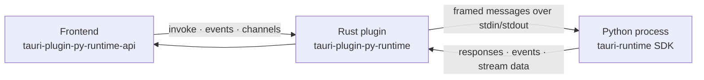

# Tauri Plugin py-runtime

[](https://crates.io/crates/tauri-plugin-py-runtime)
[](https://www.npmjs.com/package/tauri-plugin-py-runtime-api)
[](https://pypi.org/project/tauri-runtime/)
[](https://pypi.org/project/tauri-runtime/)
[](#license)
[](#platform-support)

**Build Tauri desktop apps with a Python backend.**

py-runtime lets you write the backend of a [Tauri 2](https://tauri.app) application in Python
while keeping Tauri's small footprint, native webview and security model. Python functions
become commands your frontend can call with full type information, streaming, cancellation and
structured errors. When you ship, your backend is compiled into a self-contained executable, so
end users never need to install Python.

```python
# src-python/main.py
from tauri_runtime import App

app = App()

@app.command
async def greet(name: str) -> str:
    return f"Hello {name}, from Python!"

app.run()
```

```ts
// frontend
import { pyInvoke } from "tauri-plugin-py-runtime-api";

const message = await pyInvoke<string>("greet", { name: "Tauri" });
```

## Highlights

- **Python-first commands.** Plain `def` and `async def` functions become frontend commands.
  Arguments are validated with pydantic, and camelCase keys map to snake_case automatically.
- **Real-time communication.** Stream progress over channels, exchange events in both
  directions, and send binary data without base64 overhead.
- **Production-grade reliability.** Every call supports timeouts and cancellation. The runtime
  is supervised, can restart after a crash, and shuts down gracefully with bounded deadlines.
- **Zero-dependency distribution.** `tauri-runtime build` packages the backend with Nuitka
  into a standalone executable that ships inside your app bundle, so end users never install
  Python.
- **Hardened by default.** Your Python is compiled to native code, string constants (including
  business prompts) and your module names are encrypted, and symbols are stripped — so a shipped
  build doesn't give away your source with `strings` or a quick unzip. Works on macOS, Linux and
  Windows, verified end-to-end across x86_64 and arm64 in CI; turn it off with `harden = false`.
- **One-command setup.** `tauri-runtime create` and `tauri-runtime init` scaffold a project or
  add Python to an existing one, including dependencies, configuration and permissions.
- **Scales with your codebase.** Routers with prefixes organize large backends into modules.
- **Secure by default.** Access goes through Tauri capabilities, and a webview can only cancel
  its own calls.

## How it works



The Rust plugin starts your Python backend as a child process and supervises it. The two talk
over stdin/stdout using a compact length-prefixed protocol with JSON headers and optional binary
bodies, described in [Protocol](#protocol). The frontend never talks to Python directly: every
call goes through Tauri's IPC and permission system.

| Component | Package | Install |
| --- | --- | --- |
| Rust plugin | `tauri-plugin-py-runtime` (plugin name `py-runtime`) | `cargo add tauri-plugin-py-runtime` |
| Python SDK | `tauri-runtime`, imported as `tauri_runtime` | `uv add tauri-runtime` |
| Frontend API | `tauri-plugin-py-runtime-api` | `pnpm add tauri-plugin-py-runtime-api` |

## Requirements

| Requirement | Version |
| --- | --- |
| Tauri | 2.x |
| Rust | 1.77.2 or newer |
| Python | 3.11 or newer (the SDK depends on `pydantic>=2.9`) |
| [uv](https://docs.astral.sh/uv/) | Recommended. The CLI uses it to manage the backend environment |
| C compiler | Needed only for packaging: Xcode Command Line Tools on macOS, MSVC or MinGW on Windows, gcc on Linux |

On Linux, Tauri itself needs WebKitGTK and related system libraries; see the
[Tauri prerequisites](https://tauri.app/start/prerequisites/).

## Platform support

py-runtime targets Tauri's desktop platforms. There are two modes:

- **Development mode** runs your script with a Python interpreter. It is used by `tauri dev` and
  debug builds.
- **Packaged mode** runs the standalone executable built by Nuitka. It is used by release builds
  that set `bundle`.

| Platform | Architectures | Development mode | Packaged mode | Verification |
| --- | --- | --- | --- | --- |
| macOS 11+ | Apple silicon (arm64), Intel (x86_64) | ✅ Supported | ✅ Supported | Full release build verified on Apple silicon |
| Linux | x86_64, arm64 | ✅ Supported | ✅ Supported | Runtime test suite runs in CI on Ubuntu x86_64 |
| Windows 10/11 | x86_64, arm64 | ✅ Supported | ✅ Supported | Not yet verified |
| iOS, Android | — | ❌ Not supported | ❌ Not supported | — |

"Supported" means the platform is implemented and expected to work. The Verification column
shows what has actually been tested; contributions that test the remaining platforms are welcome.

### Platform details

| | macOS / Linux | Windows |
| --- | --- | --- |
| Default interpreter | `python3` | `python` |
| Project virtual environment | `src-python/.venv/bin/python` | `src-python\.venv\Scripts\python.exe` |
| Packaged executable | `<resources>/py-backend/py-backend` | `<resources>\py-backend\py-backend.exe` |
| Console window | Not applicable | Hidden: the backend is started without a console window |

### Notes

- **Build on each target platform.** Nuitka compiles to native code for the machine it runs on and
  can't cross-compile, so build each platform's release on that platform. A CI matrix with one
  runner per OS and architecture is the simplest way to do this.
- **Mobile isn't supported.** iOS and Android don't allow an app to start a Python child process,
  which this plugin's architecture depends on.
- **Code signing.** Signing and notarizing the packaged backend are not handled yet. On macOS the
  executable and libraries inside `py-backend/` have to be signed along with the app before
  notarization. On Windows, unsigned executables may trigger SmartScreen warnings.

## Quick start

Create a new app with a Python backend:

```bash
uvx --from tauri-runtime tauri-runtime create my-app --template vue-ts --manager pnpm
cd my-app
pnpm tauri dev
```

To add a Python backend to an existing Tauri project instead, run this in the directory that
contains `src-tauri`:

```bash
uvx --from tauri-runtime tauri-runtime init
```

During development, `pnpm tauri dev` runs `src-python/main.py` with the project's virtual
environment. `pnpm tauri build` compiles the backend and bundles it into the app.

### What the CLI sets up

`create` runs `create-tauri-app` and then `init`. `init` does the following:

| Area | Change |
| --- | --- |
| Python | Creates `src-python/` with `pyproject.toml` (depends on `tauri-runtime`, with Nuitka as a dev dependency), a starter `main.py` and `.gitignore`, then runs `uv sync` |
| Rust | Adds the crate with `cargo add` and registers the plugin after `tauri::Builder::default()` in `src-tauri/src/lib.rs` |
| Frontend | Installs the API package with pnpm, yarn, bun or npm. The package manager is detected from the lockfile or `beforeDevCommand` |
| Permissions | Adds `py-runtime:default` to `capabilities/default.json` |
| Packaging | Configures `beforeBuildCommand` and `bundle.resources` in `tauri.conf.json`, and `build.rs`, as described in [Distribution](#distribution) |
| Editor | Writes `pyrightconfig.json` so that VS Code, Cursor and other pyright-based editors use `src-python/.venv`. See [Editor setup](#editor-setup) |

`create` also replaces the template's Rust `greet` command with the Python one: the frontend calls
`pyInvoke("greet", ...)` and the Rust command is removed from `lib.rs`. If the frontend can't be
switched safely, for example the plain JavaScript template that uses `window.__TAURI__`, the Rust
example is kept and the CLI prints how to switch it by hand.

Re-running the CLI is safe: files that are already set up are left alone. If `src-python`
already exists, `init` stops; `--force` continues the setup without overwriting your files. If a
step can't be applied safely, for example an unusual `lib.rs`, `Tauri.toml` or list-form
`bundle.resources`, the CLI prints exact instructions to apply it by hand.

**Package sources.** By default the CLI installs released packages from crates.io, npm and
PyPI. There are two alternatives:

- `--git` installs all three packages from the GitHub repository. With pnpm this requires pnpm
  10 or newer; the CLI passes `--allow-build` so that pnpm can build the frontend package from
  git.
- `--path <checkout>` uses a local clone of this repository. Build its frontend package first
  with `pnpm install && pnpm build`.

### Editor setup

The Python backend has its own virtual environment in `src-python/.venv`, which is created by
`uv sync`. It sits in a subfolder rather than the project root, so your editor might not find it
on its own. Until you point the editor at it, imports such as `from tauri_runtime import App`
show as unresolved and you get no completions.

`create` and `init` write a `pyrightconfig.json` to the project root, unless one already exists:

```json
{
  "venvPath": "src-python",
  "venv": ".venv",
  "executionEnvironments": [{ "root": "src-python" }]
}
```

The file works on every platform. It is read by Pylance (the Python language server in
VS Code and Cursor), pyright and basedpyright, so these editors resolve imports from the virtual
environment and between your backend modules without extra setup. That includes Zed, Neovim and
other editors that use pyright. If `src-python/.venv` doesn't exist yet, create it with
`cd src-python && uv sync`.

**PyCharm** doesn't read `pyrightconfig.json`. Open **Settings → Project → Python Interpreter →
Add Interpreter → Add Local Interpreter → Select existing** and enter
`src-python/.venv/bin/python` (`src-python\.venv\Scripts\python.exe` on Windows). Then
right-click `src-python` and choose **Mark Directory as → Sources Root**.

## Guide

### Writing commands

```python
from tauri_runtime import App, Channel, Command, Raw, TauriError

app = App()

@app.command
async def search(query: str, limit: int = 20) -> list[str]:
    ...

@app.command
def checksum(data: Raw) -> str:          # receives a Uint8Array / ArrayBuffer from the frontend
    ...

@app.command
async def export(rows: int, on_progress: Channel[int]) -> str:
    for i in range(rows):
        await on_progress.send(i)
    return "done"

@app.command("files.remove")             # register under a custom name
async def remove(path: str, ctx: Command) -> None:
    if not path:
        raise TauriError("bad_path", "path is empty", {"path": path})

app.run()
```

**Execution model**

- `async def` commands run on the event loop. Plain `def` commands run in a thread pool.
- Cancelling a call cancels the asyncio task of an `async def` command. A plain `def` command
  keeps running in its worker thread until it returns, because Python can't interrupt threads,
  and its result is discarded.

**Arguments**

- Parameters are filled from the JSON arguments, with camelCase keys mapped to snake_case.
- A missing required parameter fails with `invalid_args`.
- Annotated parameters are validated with pydantic. A validation failure fails with
  `invalid_args`, and the validation errors are sent as `data`.

**Special parameter types.** Annotate a parameter with one of these types to receive the value
described instead of a JSON value:

| Annotation | Receives |
| --- | --- |
| `Raw` | The raw request body (`data.bytes`) when the frontend passes a `Uint8Array` or `ArrayBuffer` |
| `Channel[T]` | A stream to the frontend `Channel` passed under the same name (`onProgress` → `on_progress`). Send with `await ch.send(value)`, or `ch.send_sync(value)` from a plain `def` command. The channel is valid only until the command returns |
| `Command` | The call context: `id`, `cmd`, `window` (label of the calling webview) and `cancelled` |
| `App` | The app instance |

**Return values**

- Return any value pydantic can serialize to JSON, including dataclasses and pydantic models.
- Return `Raw(...)` or `bytes` to send binary data. The frontend receives a `Uint8Array`.
- `NaN` and `±Infinity` are not valid JSON and are rejected. Returning them fails the call with
  `internal`; sending them on a channel or with `emit` raises `ValueError`.

**Errors**

- Raise `TauriError(code, message, data)` to return a structured error with your own code.
- If `data` isn't JSON-serializable, the error is sent without `data` and a `[WARN]` is logged.
- Any other exception becomes `internal` with `data = {"type": "<ExceptionName>"}`. Set
  `TAURI_RUNTIME_DEBUG=1` in the Python environment to also include the traceback.

### Using pydantic models

Use pydantic models for structured arguments and results. Add field constraints with
`Annotated[..., Field(...)]`.

```python
from datetime import datetime
from typing import Annotated, Literal

from pydantic import BaseModel, ConfigDict, EmailStr, Field, field_validator
from pydantic.alias_generators import to_camel

from tauri_runtime import App

app = App()


class Schema(BaseModel):
    """Base model that uses camelCase keys in JSON, like the frontend."""

    model_config = ConfigDict(alias_generator=to_camel, populate_by_name=True)


class UserBase(Schema):
    full_name: Annotated[str, Field(min_length=1, max_length=50)]
    email: EmailStr
    role: Literal["admin", "member"] = "member"


class NewUser(UserBase):
    @field_validator("email")
    @classmethod
    def email_not_taken(cls, email: str) -> str:
        if any(u.email == email for u in users):
            raise ValueError("email already registered")
        return email


class User(UserBase):
    id: int
    created_at: datetime


class UserPage(Schema):
    items: list[User]
    total_count: int


users: list[User] = []


@app.command
async def create_user(user: NewUser) -> User:
    created = User(**user.model_dump(), id=len(users) + 1, created_at=datetime.now())
    users.append(created)
    return created


@app.command
async def list_users(
    page: Annotated[int, Field(ge=1)] = 1,
    page_size: Annotated[int, Field(ge=1, le=100)] = 20,
) -> UserPage:
    start = (page - 1) * page_size
    return UserPage(items=users[start : start + page_size], total_count=len(users))


app.run()
```

`EmailStr` requires the `email-validator` package; install it with `uv add "pydantic[email]"`.

```ts
import { pyInvoke } from "tauri-plugin-py-runtime-api";

interface User {
  id: number;
  fullName: string;
  email: string;
  role: "admin" | "member";
  createdAt: string; // ISO 8601
}

const user = await pyInvoke<User>("create_user", {
  user: { fullName: "Ada Lovelace", email: "ada@example.com" },
});

const { items, totalCount } = await pyInvoke<{ items: User[]; totalCount: number }>("list_users", {
  pageSize: 10,
});
```

How the pieces fit:

- **Arguments.** A command's own parameters always accept camelCase keys (`pageSize` →
  `page_size`). Fields inside a model follow the model's config, so give models
  `alias_generator=to_camel` (as `Schema` does) to accept `fullName`. `populate_by_name=True`
  also accepts the snake_case names.
- **Results.** Models are serialized by alias, so `Schema` subclasses return camelCase keys
  (`createdAt`, `totalCount`). A `datetime` becomes an ISO 8601 string.
- **Validation.** Invalid input fails the call with `invalid_args` before your command runs, so
  the command body only handles valid data. Custom checks go in pydantic validators: raise
  `ValueError` in a `field_validator`, as `email_not_taken` does, and the error is reported like
  any other. `data` lists every error with its location and message.

```ts
try {
  await pyInvoke("create_user", { user: { fullName: "", email: "ada@example.com" } });
} catch (e) {
  // e.code === "invalid_args"
  // e.data: [{ loc: ["user", "fullName"], type: "string_too_short", msg: "String should have at least 1 character", ... },
  //          { loc: ["user", "email"], type: "value_error", msg: "Value error, email already registered", ... }]
}
```

For an error the frontend should handle with its own code, raise
`TauriError(code, message)` from the command instead. See [Writing commands](#writing-commands).

### Events and lifecycle hooks

```python
from tauri_runtime import Event

@app.listen("user:login")                # receives pyEmit("user:login", ...) from the frontend
async def on_login(event: Event):
    await app.emit("welcome", {"name": event.payload["name"]}, target=event.window)

@app.on("ready")
async def on_ready():
    print("Application started")
```

- A listener receives an `Event` with `name`, `payload` and `window`.
- `await app.emit(name, payload, target=None)` sends an event to the frontend. `target` is a
  webview label; without one the event is broadcast to all webviews.
- The name `exited` is reserved for the runtime's own `py://exited` event, so
  `app.emit("exited", ...)` raises `ValueError`.

There are three lifecycle hooks:

| Hook | When it runs |
| --- | --- |
| `startup` | Before the handshake. An exception aborts the runtime |
| `ready` | After the Rust side has confirmed the handshake |
| `shutdown` | When the app exits, within the shutdown timeout |

`print` is safe to use: stdout is reserved for the protocol, so `sys.stdout` is redirected to
stderr, and stderr is forwarded to the app log (see [Logging](#logging)).

### Organizing larger projects

Every decorator has an imperative counterpart: `app.add_command(func, name=None)`,
`app.add_commands(*funcs)`, `app.add_listener(event, func)` and `app.add_hook(hook, func)`.

To split a backend into modules without importing the `App` instance everywhere, group
registrations in a `Router` and mount it once in the entry file:

```python
# users.py
from tauri_runtime import Router

router = Router(prefix="user")

@router.command
async def login(name: str) -> str:  # invoked as pyInvoke("user.login", { name })
    return f"welcome {name}"

def logout() -> None: ...

router.add_command(logout)  # "user.logout"

@router.listen("app:theme")  # event names are not prefixed
def on_theme(event): ...
```

```python
# main.py
from tauri_runtime import App
import users

app = App()
app.include(users.router)
app.run()
```

- The prefix is joined with `.`. `router.include(other)` nests routers, which gives names such as
  `"user.session.login"`.
- A `Router` supports the same `command`, `listen` and `on` decorators and the same `add_*`
  methods as `App`.
- `app.include(...)` checks handler signatures and duplicate names when it mounts the router,
  and it takes a snapshot: anything added to the router afterwards is ignored.

### Calling Python from the frontend

```ts
import { Channel, pyEmit, pyInvoke, pyListen, pyStatus, PyRuntimeError } from "tauri-plugin-py-runtime-api";

const results = await pyInvoke<string[]>("search", { query: "tauri" }, { timeoutMs: 5000 });

const onProgress = new Channel<number>();
onProgress.onmessage = (n) => console.log(n);
await pyInvoke("export", { rows: 100, onProgress });

const unlisten = await pyListen("welcome", (e) => console.log(e.payload));
await pyEmit("user:login", { name: "Kylin" });

console.log(await pyStatus()); // "starting" | "running" | "crashed" | "stopped" | "failed"
```

#### `pyInvoke(cmd, args?, options?)`

**Arguments**

- `args` is either a plain object, which is sent as JSON, or a `Uint8Array` / `ArrayBuffer`,
  which is sent as raw bytes and received by a `Raw` parameter.
- `Channel` values are detected only at the **top level** of `args`. A channel nested inside an
  object or array is serialized as a plain value and is not connected to Python.
- Binary results come back as a `Uint8Array`.

**Timeouts**

- `options.timeoutMs` overrides the default invoke timeout for this call. It must be a
  non-negative integer; otherwise `pyInvoke` throws `invalid_args`.
- The value is capped at 10× the configured `invoke_timeout`, which is 5 minutes with the
  default of 30 seconds.
- On timeout the call rejects with `timeout`, and Python receives a cancel for it.

**Cancellation**

- `options.signal` takes an `AbortSignal`. On abort the promise rejects with `cancelled`
  immediately, without waiting for the backend, and a cancel is forwarded to Python.
- An already-aborted signal rejects before anything is sent.

**Call ids.** Each call carries a client call id that is scoped to the calling window:

- A webview can cancel only its own calls.
- A second call that reuses an id still pending in the same window is rejected with
  `invalid_args`.
- `pyInvoke` generates unique ids for you.

#### Channels

- Values sent with `ch.send(...)` arrive in `onmessage` in order.
- Raw bytes (`Raw` / `bytes`) arrive as an `ArrayBuffer`, not a `Uint8Array`, so declare the
  channel as `Channel<ArrayBuffer>`.
- Channel messages and the call result travel separately, so the last `onmessage` can run
  **after** `pyInvoke` has resolved. If you need strict ordering, send an explicit end marker
  on the channel (for example `{ done: true }`) and wait for it instead of relying on the
  promise.

#### Events

- `pyListen(event, handler)` listens to `py://<event>`. Python's `app.emit("x", ...)` arrives
  as `py://x`. `pyListen` returns an unlisten function.
- `pyListen("exited", ...)` (`py://exited`) fires whenever the Python process exits
  unexpectedly. Its payload is `{ code: number | null }`.
- `pyEmit(event, payload)` sends an event to Python's `@app.listen(event)` handlers. The Python
  `Event.window` is the label of the sending webview. If Python isn't running, `pyEmit` fails
  with `runtime_unavailable`.
- Event payloads are JSON. If Python emits raw bytes as an event, the frontend receives them as
  an array of numbers; use a channel or a `pyInvoke` result for binary data.

#### Error handling

Every failure rejects with a `PyRuntimeError` (`name`, `code`, `message`, optional `data`). It
mirrors the `{ code, message, data? }` error shape used across Rust and Python:

```ts
try {
  await pyInvoke("files.remove", { path: "" });
} catch (e) {
  if (e instanceof PyRuntimeError) console.log(e.code, e.message, e.data);
}
```

See [Error codes](#error-codes) for the full list.

### Configuring the Rust plugin

```rust
tauri::Builder::default()
    .plugin(
        tauri_plugin_py_runtime::Builder::new()
            .script("../src-python/main.py")
            .bundle("py-backend")
            .build(),
    )
```

| Method | Default | Description |
| --- | --- | --- |
| `script(path)` | Required unless a bundle is used | Python entry script, see [Script path resolution](#script-path-resolution) |
| `python(program)` | `<script dir>/.venv` if present, otherwise `python3` (`python` on Windows) | Interpreter to run |
| `bundle(name)` | None | In release builds, run the Nuitka-packaged backend instead, see [Distribution](#distribution) |
| `args(iter)` | None | Extra arguments passed after the script path, or to the packaged executable |
| `env(key, value)` | None | Extra environment variable for the Python process. Call repeatedly to set several |
| `invoke_timeout(Duration)` | 30 s | Default timeout per call. A per-call `timeoutMs` is capped at 10× this value |
| `shutdown_timeout(Duration)` | 3 s | Time Python gets to run its shutdown hooks |
| `handshake_timeout(Duration)` | 10 s | Time Python gets to start and send its handshake. Calls made while the runtime is starting wait this long too |
| `restart_on_crash(bool)` | `false` | Restart the process after a crash, see [Process lifecycle](#process-lifecycle) |

The Python process always gets `PYTHONUNBUFFERED=1` and `PYTHONIOENCODING=utf-8`.

From Rust code you can reach the runtime with `app.py_runtime().supervisor()` (via
`PyRuntimeExt`), for example to call commands or read the status.

#### Configuration file

The same settings can be set in `plugins.py-runtime` in `tauri.conf.json`, except `env` and
`handshake_timeout`, which are available only on the `Builder`. Keys are camelCase, and unknown
keys are rejected so that a typo fails at startup instead of being silently ignored:

```json
{
  "plugins": {
    "py-runtime": {
      "python": "python3",
      "script": "../src-python/main.py",
      "bundle": "py-backend",
      "args": ["--verbose"],
      "invokeTimeoutMs": 30000,
      "shutdownTimeoutMs": 3000,
      "restartOnCrash": false
    }
  }
}
```

Values set on the `Builder` take precedence over the configuration file. To configure the plugin
only through the file, register it with `tauri_plugin_py_runtime::init()`.

#### Permissions

Add `"py-runtime:default"` to your capability. It allows `invoke`, `cancel`, `emit` and
`status`; the individual permissions are named `py-runtime:allow-<name>`.

#### Script path resolution

- An absolute path is used as is.
- A relative path is tried against the following locations, and the first existing file wins:
  1. Debug builds only: the process working directory. Under `tauri dev` that is `src-tauri`,
     so `"../src-python/main.py"` points at `<project>/src-python/main.py`.
  2. The app's resource directory, with every `..` component replaced by `_up_`. This is the
     same layout Tauri's bundler uses for `bundle.resources`.
- Release builds look only in the resource directory, so a script that runs in release builds
  has to be shipped via `bundle.resources`, in one of two forms:
  - List form: `"resources": ["../src-python/**/*"]` together with
    `script: "../src-python/main.py"`.
  - Map form: `"resources": { "../src-python/": "src-python/" }` together with
    `script: "src-python/main.py"`.
- If nothing is found, plugin setup fails with an error that lists every path it tried.
- Python runs with the script's directory as its working directory.

In script mode the interpreter must be able to import `tauri-runtime` (and therefore
`pydantic`). Without an explicit `python`, the plugin uses the virtual environment next to the
script (`.venv/bin/python`, or `.venv\Scripts\python.exe` on Windows), so running `uv sync` in
`src-python` is all `tauri dev` needs.

## Distribution

`tauri-runtime build` compiles the Python backend with [Nuitka](https://nuitka.net) in
standalone mode. The result is a folder containing an executable, the Python runtime and all
dependencies, so your users don't need Python installed. Debug builds keep running the script
for fast iteration; release builds with `bundle` set run the packaged executable.

Projects created with `tauri-runtime create` or `init` are already configured. To set up
packaging by hand:

1. **Add Nuitka** to the Python project:

   ```bash
   cd src-python && uv add --dev nuitka
   ```

2. **Configure the build** in `src-python/pyproject.toml`. This step is optional; the values
   below are the defaults:

   ```toml
   [tool.tauri-runtime.build]
   entry = "main.py"      # entry script
   name = "py-backend"    # executable and folder name
   output = "dist"        # output directory
   nuitka-args = []       # extra Nuitka arguments, e.g. ["--include-data-dir=assets=assets"]
   harden = true          # enable the hardening plugin, see Hardening
   ```

   `uv run tauri-runtime build` produces `dist/py-backend/py-backend` (`py-backend.exe` on
   Windows). Arguments after `--` are passed to Nuitka. The build runs in a temporary directory
   and replaces the previous output only if it succeeds.

3. **Build before the app and bundle the output** as a resource in `tauri.conf.json`.
   `beforeBuildCommand` runs in the directory that contains `src-tauri`:

   ```json
   {
     "build": {
       "beforeBuildCommand": "pnpm build && cd src-python && uv run tauri-runtime build"
     },
     "bundle": {
       "resources": { "../src-python/dist/py-backend/": "py-backend/" }
     }
   }
   ```

   tauri-build checks that resource paths exist even for `tauri dev`, so create the folder in
   `src-tauri/build.rs` before the backend is first packaged:

   ```rust
   fn main() {
       std::fs::create_dir_all("../src-python/dist/py-backend").expect("failed to create the Python bundle directory");
       tauri_build::build()
   }
   ```

4. **Point the plugin at the bundle:**

   ```rust
   tauri_plugin_py_runtime::Builder::new()
       .script("../src-python/main.py") // debug builds
       .bundle("py-backend")            // release builds: <resources>/py-backend/py-backend
       .build()
   ```

**Notes**

- The switch between script and bundle follows `debug_assertions`, so `tauri build --debug`
  still runs the script.
- In release builds, `python` and `script` are ignored when `bundle` is set. If the executable
  isn't found, plugin setup fails with the path it looked for.
- Nuitka follows imports. Modules that are imported dynamically, and data files, need extra
  `nuitka-args` such as `--include-module`, `--include-package-data` or `--include-data-dir`.
- The first build takes a few minutes. Nuitka caches compiled C files (ccache), so later builds
  are faster.

### Hardening

Nuitka standalone builds are easy to inspect: compiling to C still leaves string constants and
module names sitting in the binary, where `strings` reads them straight out. To make casual
inspection harder, `tauri-runtime build` ships a Nuitka plugin that is **enabled by default**. It
runs on macOS, Linux and Windows, and does four things:

- **Your code is compiled to C; third-party packages are packaged as bytecode.** Compiling
  libraries to C buys almost no runtime speed (the bottleneck is the network, the webview or the
  model) but accounts for most of the compile time, so only your own code is compiled.
- **Constant blocks are encrypted.** String constants — including business prompts and the
  static parts of f-strings — are encrypted at build time and decrypted at runtime, so they no
  longer appear in plaintext in the binary.
- **Module names are encrypted.** Your own module names (such as `app.ai.analysis`) live in
  Nuitka's module loader table rather than the constant block; they are encrypted too.
  Third-party names are left alone, since they are public anyway.
- **Symbols are stripped.** Local function names are removed from the symbol table so the set of
  functions isn't visible. On macOS the backend is re-signed with an ad-hoc signature afterwards,
  which Tauri's final signing then supersedes.

**What "your own code" means.** Module-name encryption applies only to modules under the project
root. The CLI sets the working directory to your project during the build, so this works out of
the box; when calling Nuitka by hand, set `TAURI_RUNTIME_PROJECT_ROOT` to the project directory.

**This is obfuscation, not real encryption.** The key and the algorithm are inside the binary,
and at runtime everything is plaintext in memory. The goal is to defeat direct `strings`-style
searches, not a determined reverse engineer.

**Turning it off and build caching.** Set `harden = false` in `[tool.tauri-runtime.build]` to
disable it. By default a fresh random key is used on every build, which invalidates Nuitka's
ccache and forces a full recompile (several minutes). For reproducible builds and ccache hits,
pin the key with the `TAURI_RUNTIME_HARDENING_KEY` environment variable (for example
`0xA5C3F17B`); the generated C then stays identical across builds.

## Reference

### Error codes

| Code | Meaning |
| --- | --- |
| `command_not_found` | No Python command with that name |
| `invalid_args` | Bad arguments: a missing parameter, pydantic validation failure or malformed request |
| `internal` | Unhandled Python exception or internal error |
| `cancelled` | The call was cancelled |
| `timeout` | The call exceeded its timeout |
| `runtime_unavailable` | Python isn't running: it failed to start, its handshake failed or timed out, or it was stopped |
| `runtime_exited` | Python exited while the call was in flight |
| `protocol_mismatch` | The Python SDK speaks a different protocol version |
| `frame_too_large` | A message exceeded the 64 MiB frame limit |

Codes raised with `TauriError` in Python are passed through unchanged.

### Process lifecycle

**Startup**

- The Python process starts during plugin setup.
- Python sends a handshake that lists its commands. Rust checks the protocol version and
  replies; then `ready` hooks run and the status becomes `running`.
- Calls made while the runtime is starting wait for the handshake.

**Crashes and restarts**

- If Python exits unexpectedly, in-flight calls fail with `runtime_exited`, `py://exited` is
  emitted and the status becomes `crashed`.
- With `restart_on_crash` / `restartOnCrash` enabled (it is off by default), the process is
  restarted with exponential backoff: 1 s, 2 s, 4 s and so on, capped at 30 s.
- The backoff resets once a process has stayed up for at least 30 s.
- If a restarted process fails its handshake, restarting stops and the status becomes
  `failed`.

**Shutdown**

- On app exit, Rust sends a `shutdown` message with `timeoutMs`, set to the shutdown timeout.
- Python cancels running calls and runs `shutdown` hooks, all within that one time budget. An
  invalid `timeoutMs`, or a closed stdin, falls back to 3 s. Python then exits.
- Handlers that ignore cancellation, and stuck `def` handlers, are abandoned rather than awaited.
- If the process is still alive after the shutdown timeout plus 1 s of grace, it is killed.

**`app.run()` always ends the process.** If an exception escapes, including `sys.exit()` or
`KeyboardInterrupt` raised from a handler, it flushes output and exits with the `sys.exit` code,
or with 1 for any other exception.

### Logging

Python's stderr, including `print` output (which is redirected there), is forwarded line by line
to the Rust `log` crate under target `py-runtime`. A leading `[DEBUG]`, `[INFO]`, `[WARN]` or
`[ERROR]` selects the level and is stripped; other lines are logged at `INFO`:

```python
print("[WARN] disk almost full")   # -> WARN  py-runtime: disk almost full
```

Install a logger such as `tauri-plugin-log` to see the output.

### Protocol

Rust and Python exchange frames over the child process's stdin/stdout. The current protocol
version is 2.

**Frame layout**

- Every frame is `[u32 BE length][u32 BE header length][header JSON][body]`.
- The outer length counts everything after itself and is capped at 64 MiB.
- The header is one JSON object tagged by `type`:

| `type` | Direction | Fields |
| --- | --- | --- |
| `hello` | Python → Rust | `protocol`, `sdk`, `commands` |
| `ready` | Rust → Python | `protocol`, `app: { name, version }` |
| `shutdown` | Rust → Python | `timeoutMs` |
| `request` | Rust → Python | `id`, `cmd`, `channels?` (argument name → channel id), `window?`, payload |
| `response` | Python → Rust | `id`, payload |
| `error` | Python → Rust | `id`, `code`, `message`, `data?` |
| `cancel` | Rust → Python | `id`, `reason` (`"client"` or `"timeout"`) |
| `event` | Both | `event`, `target?` (Python → Rust), `window?` (Rust → Python), payload |
| `channel_data` | Python → Rust | `channel`, payload |
| `channel_close` | Python → Rust | `channel` |

**Payloads**

- A payload is either a JSON value inline in the header as `value` (an absent `value` means
  none, or `null`), or binary data in the frame body with `"raw": true`.
- The body must be empty unless `raw` is set.
- `NaN` and `±Infinity` are never sent.

**Error handling**

- Unknown header fields are ignored.
- A frame whose header can't be decoded is logged and skipped. That covers invalid JSON, an
  unknown `type`, and a missing or mistyped field.
- An oversized frame ends the connection.
- If the first frame from Python isn't a decodable `hello` with the same protocol version,
  startup fails with `protocol_mismatch`.

**Implementation.** The message types are a serde enum on the Rust side
(`bridge::protocol::Message`) and pydantic models on the Python side (`tauri_runtime.protocol`).
`python-sdk/tests/fixtures/golden_frames.json` holds one encoded frame per message type, and
both test suites encode and decode them byte for byte.

## Example

`examples/vue` is a complete Vue application that demonstrates commands, raw bytes,
concurrency, errors, timeouts, cancellation, channels and events. Its backend in
`examples/vue/src-python` is a standalone uv project that depends on the in-repo SDK in editable
mode.

```bash
cd examples/vue/src-python && uv sync   # create the backend environment (includes Nuitka)
cd .. && pnpm install && pnpm tauri dev
pnpm tauri build                         # release build with the packaged backend
```

## Development

```bash
cd python-sdk && uv sync                # SDK environment, used by the Rust integration tests
cargo test                              # Rust unit and integration tests ($PYTHON overrides the interpreter)
cd python-sdk && uv run pytest          # Python SDK tests
pnpm install && pnpm build              # build the frontend API (guest-js)
```

## Roadmap

| Stage | Scope | Status |
| --- | --- | --- |
| 1. Runtime core | Process supervision, protocol, commands, events, channels, Python SDK and frontend API | Available |
| 2. Build toolchain | Standalone packaging with Nuitka, hardening and project scaffolding | Available; signing and cross-platform verification pending |
| 3. Desktop native APIs | Native desktop capabilities exposed to Python | Planned |
| 4. System extensions | Deeper operating system integration | Planned |
| 5. Hardware access | Access to devices and peripherals | Planned |

## License

Licensed under either of [MIT](LICENSE-MIT) or [Apache-2.0](LICENSE-APACHE) at your option.
